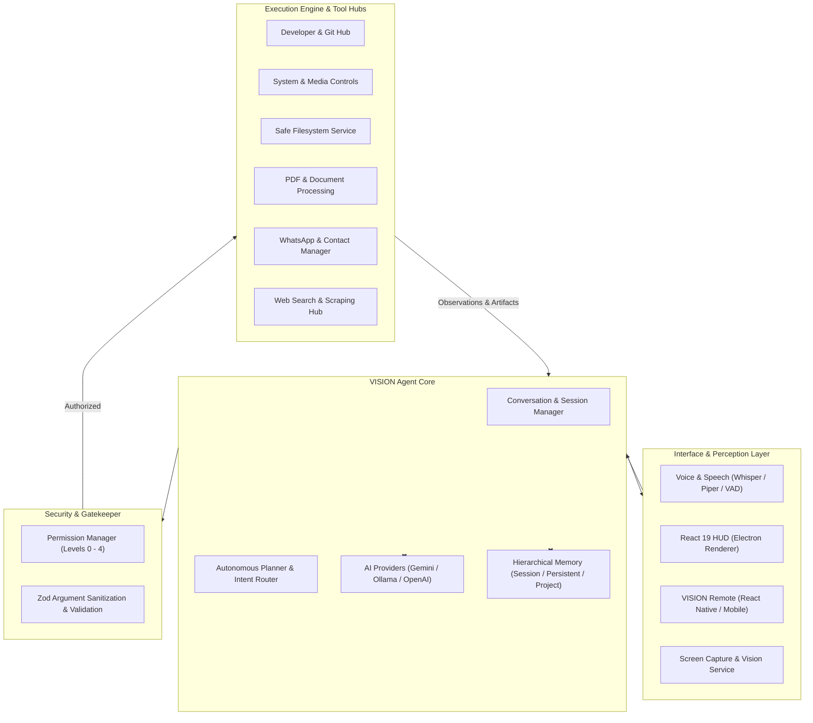

# VISION — Personal AI Operating System

<div align="center">


### *Turn Natural Human Intent into Safe, Verified, Real-World Action.*

[](https://www.typescriptlang.org/)
[](https://www.electronjs.org/)
[](https://react.dev/)
[](https://tailwindcss.com/)
[](https://vitejs.dev/)
[](https://www.python.org/)
[](https://expo.dev/)
[](LICENSE)

[English](#overview) • [العربية](#نظرة-عامة-عن-المشروع) • [Architecture](#core-architecture) • [Features](#key-capabilities) • [Installation](#getting-started) • [Remote Companion](#vision-remote-mobile-gateway)

</div>

---

## Overview

**VISION** is an AI-native desktop operating system and autonomous personal assistant. Inspired by the ambition of JARVIS, VISION is built from the ground up as an original modular operating system that bridges advanced multimodal reasoning with deterministic, safe execution on the user's host machine.

VISION is **not** a basic chatbot, a wrapper around an LLM API, or a simple voice recorder. It is a full-fledged **Personal AI Operating System** with its own execution loop, granular permission gates, modular tool hubs, persistent memory hierarchies, and a cross-platform companion mobile gateway.

### The North Star
> **Make VISION effortlessly understand human intent and safely turn that intent into real-world digital action.**

```
Understand ➔ Plan ➔ Permission Gate ➔ Act ➔ Observe ➔ Verify ➔ Respond
```

---

## نظرة عامة عن المشروع

**VISION** هو **نظام تشغيل ذكاء اصطناعي مكتبي متكامل (Personal AI Operating System)** ومساعد شخصي مستقل فائق التطور، مستوحى من طموح شخصية JARVIS ولكن بهندسة برمجية أصلية وهوية تقنية مستقلة ومتقدمة.

صُمم VISION ليتحول من مجرد "شات بوت يولد نصوصاً" إلى **منظومة متكاملة تفهم النية البشرية الطبيعية — باللغة العربية الفصحى، العامية المصرية الدقيقة، والإنجليزية التقنية — وتحولها إلى إجراءات حقيقية، موثوقة وآمنة على نظام التشغيل وتطبيقات سطح المكتب والويب**.

### 🌟 أبرز الركائز الأساسية للمشروع:
- **🗣️ ذكاء صوتي ثنائي فوري**: استماع وتحدث بالعربية والانجليزية محلياً بدون إنترنت عبر `whisper.cpp` و `piper-tts` مع كاشف نطق ذكي (VAD).
- **👁️ إدراك بصري وتفاعل مع الشاشة**: قراءة محتوى الشاشة والنوافذ النشطة وتحليلها بالذكاء الاصطناعي متعدد الوسائط (Multimodal Vision).
- **🛠️ منصات أدوات متكاملة (Tool Hubs)**: التحكم في الملفات، سطر الأوامر (Terminal)، متصفح الويب، مستندات PDF/Word، جهات الاتصال، ورسائل WhatsApp.
- **🛡️ أمان صارم وصلاحيات متعددة المستويات (5-Tier Security)**: الذكاء الاصطناعي لا يملك تصريحاً مباشراً؛ كل عملية تمر عبر مصفوفة حماية وتأكيد بشري عند العمليات الحساسة.
- **📱 رفيق الموبايل (VISION Remote)**: تطبيق للهواتف الذكية بتقنية React Native / Expo يتصل تلقائياً بالجهاز عبر الشبكة المحلية للمحادثة والموافقة على العمليات عن بُعد.

---

## Visual Showcase

<div align="center">

### Panoramic AI Workstation HUD


---

### Holographic Command Center HUD


---

### Multimodal Screen Analysis & Visual Reasoning


---

### Dynamic Audio & Listening State


---

### Real-Time Reasoning & Plan Evaluation


---

### System Telemetry & Core Matrix Interface


</div>

---

## Core Architecture

VISION enforces a strict separation between **Intelligence**, **Permissions**, and **Execution**. The AI model is treated as a reasoning engine, **never** an authorization layer.



---

## Key Capabilities

### 🎙️ 1. Ultra-Low Latency Voice & Audio Hub
- **Local & Cloud STT**: High-accuracy transcription with support for Arabic, Egyptian dialect (`ar-EG`), and technical English via native `whisper.cpp` or Hugging Face ASR.
- **Local Neural TTS**: Natural offline voice synthesis powered by Piper ONNX models (`ar_JO-kareem` and `en_US-lessac`).
- **Silero Voice Activity Detection (VAD)**: Real-time speech thresholding for seamless voice interactions without pressing buttons.
- **Continuous Wake-Word Recognition**: Wake the assistant hands-free with acoustic feedback and visual state indication.

### 👁️ 2. Multimodal Vision & Screen Understanding
- **Live Desktop Vision**: Instant capture of displays, active application windows, or specific regions.
- **Deep Visual Inspection**: Visual reasoning via Gemini Multimodal Vision API or local Ollama vision models (`llama3.2-vision`).
- **OCR & GUI Comprehension**: Detect UI elements, buttons, errors, terminal outputs, and system dialogues in real-time.

### 🛠️ 3. Comprehensive Tool Hubs & Action Registry
All capabilities are exposed as structured, declarative tools with strict Zod validation:

| Tool Hub | Key Features & Capabilities |
| :--- | :--- |
| **Developer & Git** | Status, Diff, Log, Branch, Commit, Push, Checkout, Codebase Search, Terminal execution with timeout & cwd controls. |
| **Safe Filesystem** | Sandboxed file read/write, directory listing, recursive tree search, metadata inspection, file safety limits. |
| **System & Media** | Master volume & mute control, display brightness, clipboard read/write, active window management, process inspection. |
| **Document Engine** | PDF text extraction, programmatic multi-page PDF generation with `pdf-lib`, DOCX parsing with `mammoth`, Markdown & KaTeX rendering. |
| **Communication** | Parsing `.vcf` contact address books, Arabic name phonetic normalization, automated WhatsApp messaging & media attachments. |
| **Web & Intelligence** | DuckDuckGo / Brave web search, live article scraping, real-time weather forecasting, timezones & geography reasoning. |

### 🛡️ 4. Five-Tier Security & Permission Architecture
Every action is audited against a granular permission matrix before touching the host system:

| Level | Risk Tier | Behavior | Example Actions |
| :---: | :--- | :--- | :--- |
| **L0** | Read-Only | Automatic execution | Time check, weather forecast, system telemetry, read file. |
| **L1** | Low Risk | Automatic execution | Adjust volume, take screenshot, search web, focus window. |
| **L2** | Moderate Risk | Notification / Soft confirmation | Create new file, run safe terminal command, open browser URL. |
| **L3** | High Risk | **Explicit user confirmation required** | Modify system settings, commit/push code, execute shell scripts. |
| **L4** | Critical / Destructive | **Explicit interactive approval** | Delete files, format directories, send external WhatsApp messages. |

### 📱 5. VISION Remote (Mobile Companion App)
- Companion React Native application built with Expo.
- **Zero-Configuration Discovery**: Automatic local network pairing via UDP broadcast and QR code scanning.
- **Bi-directional WebSocket Gateway**: Real-time duplex communication with the desktop OS.
- **Remote Approvals**: Push notifications for Level 3/4 permission requests, allowing mobile biometric approval.
- **Remote Voice & Vision**: Send voice prompts and receive live desktop feed on your phone.

---

## Tech Stack

### Core Technologies
- **Runtime & Language**: [Node.js](https://nodejs.org/) (ESM) & [TypeScript 5.8](https://www.typescriptlang.org/)
- **Desktop Shell**: [Electron 35](https://www.electronjs.org/) (Isolated Preload Bridge, Context Isolation, Secure IPC)
- **Frontend UI**: [React 19](https://react.dev/), [Tailwind CSS 3.4](https://tailwindcss.com/), [Lucide Icons](https://lucide.dev/)
- **Build System**: [Vite 6.2](https://vitejs.dev/) & [vite-plugin-electron](https://github.com/electron-vite/vite-plugin-electron)
- **Validation**: [Zod](https://zod.dev/) for strict runtime parameter schemas
- **Document Processing**: `pdf-lib`, `pdf-parse`, `mammoth`, `marked`, `katex`
- **Mobile Companion**: [React Native](https://reactnative.dev/), [Expo](https://expo.dev/), [Zustand](https://zustand-demo.pmnd.rs/)
- **Speech & Audio Services**: Python 3.10+, `whisper.cpp`, `piper-tts`, `silero-vad`
- **AI Providers**: Google Gemini API (`gemini-2.5-flash`, `gemini-1.5-pro`), Ollama (Local LLM), OpenAI API

---

## Getting Started

### Prerequisites
- **Node.js**: `v20.x` or higher
- **npm**: `v10.x` or higher
- **Python**: `v3.10` or higher (for speech microservices)
- **Git**

### 1. Clone the Repository
```bash
git clone https://github.com/Ahm3d0x/VISION.git
cd VISION
```

### 2. Install Dependencies
```bash
# Install desktop OS dependencies
npm install

# Install mobile companion dependencies (optional)
cd vision-remote
npm install
cd ..
```

### 3. Configure Environment Variables
Copy the `.env.example` file to `.env`:
```bash
cp .env.example .env
```
Edit `.env` and fill in your API credentials:
```env
GEMINI_API_KEY=your_gemini_api_key_here
VITE_GEMINI_API_KEY=your_gemini_api_key_here
OPENAI_API_KEY=your_openai_api_key_here

# Local Ollama (Optional)
OLLAMA_HOST=http://127.0.0.1:11434
```

### 4. Setup Speech Models (Optional for Local Voice)
Consult [models/README.md](./models/README.md) for direct download links to local Whisper GGML models and Piper ONNX Arabic/English voices.

### 5. Launch VISION Desktop OS
```bash
npm run dev
```

### 6. Run Python Speech Services (Optional)
```bash
# In a separate terminal
python services/asr_server.py
python services/tts_server.py
```

### 7. Run VISION Remote Companion
```bash
cd vision-remote
npx expo start
```
Scan the QR code with **Expo Go** on iOS or Android.

---

## Project Structure

```plaintext
VISION/
├── .agents/                 # System identity, architecture rules & memory
├── UIPNG/                   # High-resolution HUD interface captures
├── models/                  # Offline ASR, TTS, and VAD model weights & guide
│   └── README.md
├── services/                # Standalone Python speech microservices
│   ├── asr_server.py        # Speech-to-Text WebSocket service
│   ├── tts_server.py        # Text-to-Speech WebSocket service
│   └── config.py
├── src/
│   ├── core/                # Agent Core & Domain Hubs
│   │   ├── agent/           # Autonomous multi-step AgentCore loop
│   │   ├── contacts/        # Address book parsing & normalization
│   │   ├── execution/       # Tool execution engine & observer
│   │   ├── memory/          # Hierarchical session & persistent memory
│   │   ├── permissions/     # 5-Tier permission gatekeeper
│   │   ├── providers/llm/   # Model abstraction (Gemini, Ollama, OpenAI)
│   │   ├── tools/           # Modular tool registry & builtin tool hubs
│   │   └── vision/          # Screen capture & multimodal vision analysis
│   ├── gateway/             # Remote mobile bridge & WebSocket server
│   ├── main/                # Electron Main process & privileged services
│   ├── preload/             # Context-isolated IPC bridge
│   ├── renderer/            # React 19 Holographic HUD interface
│   └── shared/              # Cross-layer types, protocol schemas & utilities
├── test/                    # Comprehensive unit & integration test suites
├── vision-remote/           # React Native Expo mobile companion app
├── package.json
├── tailwind.config.js
├── tsconfig.json
└── vite.config.ts
```

---

## Roadmap

- [x] **Phase 0 — Foundation**: Modular desktop shell, context isolation, IPC security, Vite build system.
- [x] **Phase 1 — Multimodal Voice**: Arabic/Egyptian/English speech recognition, neural TTS, Silero VAD.
- [x] **Phase 2 — Computer Control**: Application launcher, safe filesystem, system & media controls.
- [x] **Phase 3 — Tool Registry & Permissions**: Type-safe Zod tools, 5-tier permission model, observation recovery.
- [x] **Phase 4 — Vision & Screen Reasoning**: Screen capture, multimodal vision analysis, window inspection.
- [x] **Phase 5 — Mobile Remote Companion**: Zero-conf discovery, QR pairing, remote approvals, mobile chat.
- [x] **Phase 6 — Developer & Document Suite**: Git automation, terminal execution, PDF generation, DOCX parsing.
- [ ] **Phase 7 — Proactive Automation**: Scheduled workflows, background event triggers, autonomous cron tasks.
- [ ] **Phase 8 — Cloud Sync & Vector Memory**: Supabase integration, pgvector RAG for codebase indexing.

---

## Author & Creator

**Ahmed Mohamed Attia**
- Electronics & Communications Engineering Student — Zagazig University, Egypt
- Specialization: Digital IC Design, RTL / VLSI, Embedded Systems & AI-Driven Software
- GitHub: [@Ahm3d0x](https://github.com/Ahm3d0x)
- LinkedIn: [Ahmed Mohamed Attia](https://linkedin.com/in/ahm3d0x)

---

## License

This project is licensed under the [MIT License](LICENSE).
